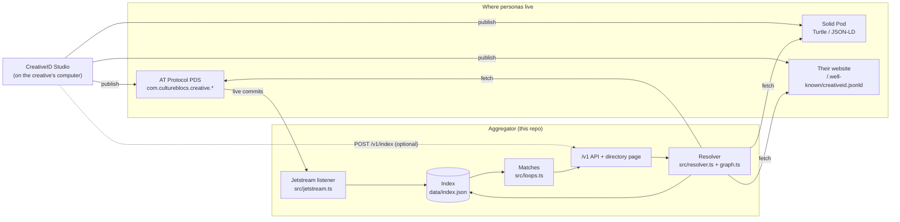

# CreativeID Aggregator: architecture

*Updated 2026-10-20 (M6–M7). Moved here from the studio repo, where it began as the design analysis for this service; the original is in `creativeid-studio`'s history.*

## The problem it solves

Creatives publish their personas wherever suits them: an AT Protocol PDS (Bluesky, Eurosky, self-hosted), a Solid Pod, or a file on their own website. A festival, a funder or a venue can't search across all of those, or tell when two people's accounts of working together match. The aggregator gathers what was published into one searchable index and computes those matches. It is a **cache**: it owns nothing, any entry can be rebuilt from its source, and anyone can run another.

## How it fits

## Getting data in: four patterns

AT Protocol pushes changes to the whole network; Solid Pods and websites have to be pulled. So the aggregator combines four patterns:

| Pattern | Covers | Status | Notes |
|---|---|---|---|
| **Ping on publish** (`POST /v1/index`) | All three | Built | The studio sends it after each publish when a directory is configured. Cheap, and the only way to discover new Pods and websites without a central registry. |
| **Jetstream** (filtered firehose) | AT Protocol | Built, opt-in (`JETSTREAM=on`) | Subscribes to the three creative collections only, so traffic is tiny. Has a cursor file and back-off. Finds personas nobody pinged about. |
| **On-demand resolve** (`GET /v1/personas/:id?resolve=true`) | All three | Built | Any DID, handle, URL or domain works on first use. |
| **Conditional re-polling** (`ETag` / `If-None-Match`) | Solid, websites | Not built | ETags are already stored; a refresher job would keep file-based personas current without re-downloading. |

Whatever the route, the same normaliser (`src/graph.ts`) turns ATProto records, JSON-LD and Turtle into one shape. A test proves all three give an identical persona, using fixtures generated from the studio's own code. Published data is untrusted: values are type-checked and capped at lexicon limits, documents are limited to 256 KB and 10 s, and a public instance refuses to fetch from private networks.

## Matches

A match exists when two parties independently say the same thing. Nobody approves anything:

- **Peer:** A's connection names B's DID, and B's names A's.
- **Work:** X points at a work record in Y's repository. If X pinned the work's CID and Y has since edited it, the match says *changed since confirmed*.

Matches are computed from the index on read and shown as sentences. There are no scores and no badges; one-sided claims are normal and shown as such.

## Storage and scale

The index is one JSON file, held in memory and written atomically. That's right for a prototype and for a directory of a few thousand personas. Beyond that, the original analysis recommended:

| Tier | Stack | Fits | Rough monthly cost* |
|---|---|---|---|
| **A. Single node** (recommended next step) | Node + SQLite (WAL, FTS5 for search) + the Jetstream listener as a long-running process | ~100k personas | about $5–7 on a small VPS |
| B. Serverless edge | Workers + D1 + a Durable Object for Jetstream | Heavy read traffic | $0–5 at low volume, rising with crawling |
| C. Managed cloud | Containers + managed Postgres + Redis | Multi-region, contractual uptime | $50–200+ |

\* Estimates carried over from the October 2026 analysis; not re-checked.

Moving from the JSON file to SQLite is contained in `src/indexer.ts`, which already exposes everything the server needs (find, search, works, connections, matches, stats).

Cheap choices that matter at any tier:
- Jetstream filtered to the creative collections, never the raw relay firehose.
- Conditional GETs for files.
- One well-known path for website-hosted personas, so a bare domain is enough.

## Known gaps

- **Duplicates across protocols.** The same persona on AT Protocol and Solid appears twice, because nothing links the copies. A fix: the studio writes the persona's DID into its published graph (`sameAs`), and the index merges on it.
- **Peer matches need DIDs,** so file- and Solid-based personas can make claims but can't be the far end of a peer match.
- **The private-network check is by host name;** DNS rebinding isn't covered. A public instance should also restrict outbound traffic.
- **No re-polling of files yet** (see above). File-based personas refresh only when pinged or resolved.
- **The handle is taken from the DID document** (or the ping). Jetstream identity events update it; there's no periodic re-check.
